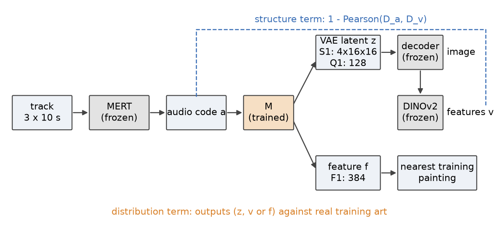
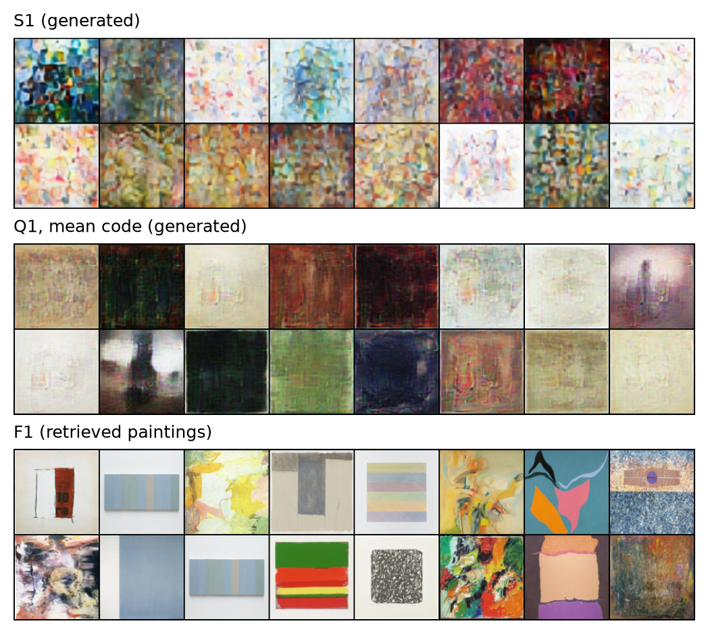
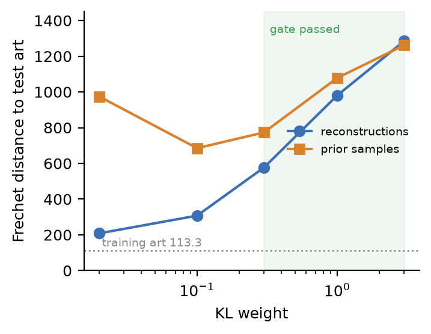
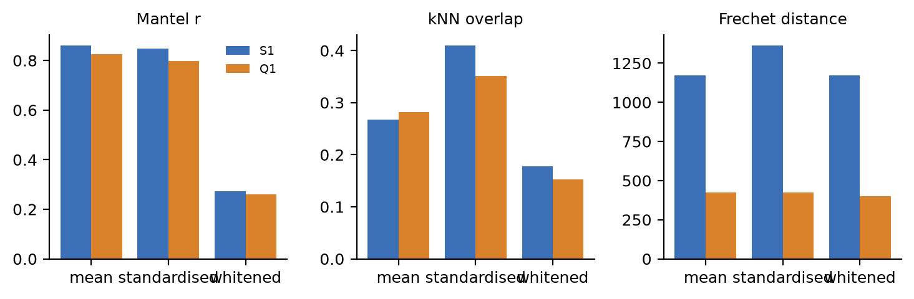
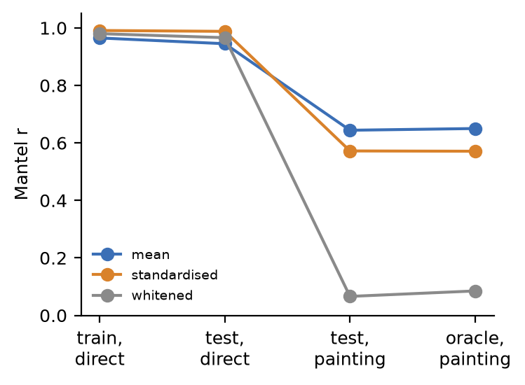
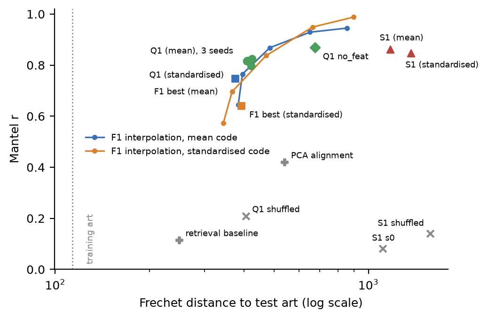
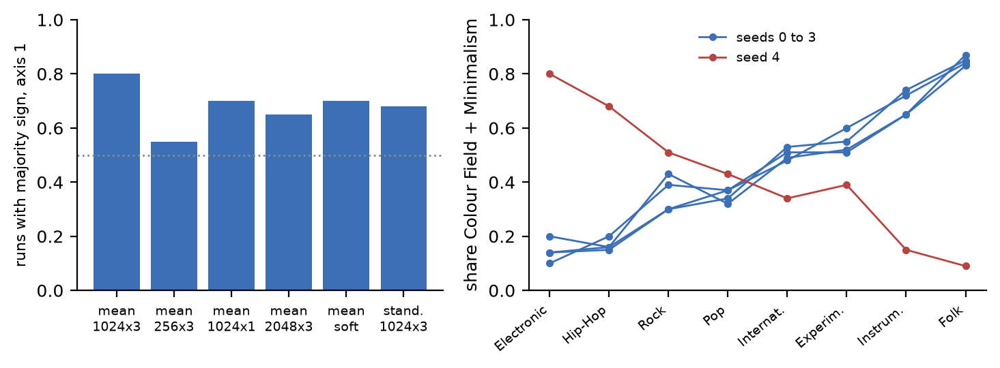

# What Distance Matching Alone Determines: Mapping Music to Abstract Images with Frozen Self-Supervised Encoders, without Text or Paired Data

Arunav Ganguly, Aman Dhingra, Sourabh Singh Verma

Affiliations and contact: to be added by the authors.

Draft of 2026-11-15. Every number is taken from `docs/run_log.md`; the tables of `docs/paper1/results.md` give the source entry of each value. Figures are produced by `docs/paper1/make_figures.py`.

## Abstract

We study the mapping of music to abstract images under three constraints: no text-supervised model, no paired data and no human labels in training. 7994 tracks of FMA-small and 5832 abstract paintings from WikiArt are encoded by frozen self-supervised encoders (MERT-v1-95M and DINOv2 ViT-S/14). A mapping network is trained so that distances between its outputs correlate with distances between audio codes, while a distribution term matches the outputs to the art collection. Three bridges are compared: a spatial VAE latent (S1), a vector VAE latent with a feature-space distribution term (Q1), and image-feature space with retrieval of the nearest real painting (F1). On 789 held-out tracks, Q1 reaches a Mantel correlation of 0.815 to 0.825 over three seeds; permuting the audio distances lowers it to 0.209. The audio code, not the bridge, decides how much structure is transferred, and the bridge decides how close the outputs are to the art distribution. Structure and closeness to the art distribution trade off along one curve, and retrieval is limited by the sparsity of a finite collection. Under a second self-supervised image encoder that was not used in training, 55 to 80 % of the correlation remains; under pixel statistics most of it is absent. The leading audio axis, a contrast between acoustic and electronic material, is mapped to the leading art axis under every random initialisation (mean absolute correlation 0.89 over 100 runs), but its orientation is not identified: the majority orientation holds in about 70 % of 180 runs, and the two orientations are equal in loss and in learning speed. Distance matching fixes the coarse correspondence and nothing finer. No human evaluation has been made.

## 1. Introduction

Systems that turn sound into images usually obtain the correspondence from people. Some use text as an intermediate: audio is described or embedded in a space shared with language, and a text-to-image model draws the result [8, 10]. Others use pairs: video frames with their sound track, album covers with their albums, or pairs assembled by a vision-language model [9]. In both cases the mapping reproduces associations that humans wrote down or produced.

This paper asks what remains when these sources are removed. The setting has two unrelated collections, music tracks and abstract paintings, and two frozen encoders trained without text. No track is associated with any image, no label enters training, and no rule relating properties of sound to properties of images is written by hand. The only assumption about the mapping is relational: tracks that are close to each other should receive images that are close to each other, and tracks that are far apart should receive images that are far apart. A second term asks that the set of outputs looks like the art collection.

This is a weak constraint, and the purpose of the paper is to measure exactly what it determines and what it leaves open. We train three bridges that differ in where the output of the mapping lives (two VAE latent spaces and the image-feature space itself), evaluate them on held-out tracks against controls, and analyse the solutions across random initialisations.

The contributions are:

1. A protocol for unpaired, text-free music-to-image mapping with controls that separate the effect of the structure term from the effect of the distribution term and of network smoothness: a variant without the structure term, a variant with permuted audio distances, and an untrained mapping (Sections 5 and 6).
2. Evidence that the structure term transfers the distance structure of the audio code to images on held-out tracks, in generated images (S1: r 0.861, one seed; Q1: 0.815 to 0.825, three seeds) and in retrieved real paintings (F1: 0.641 to 0.747, five seeds), while the controls stay between 0.06 and 0.30 (Section 7.1).
3. A separation of roles: the audio code decides the structure score, the bridge decides the distance to the art distribution (Section 7.3).
4. A localisation of the loss of structure. Removing the generator (F1) shows that the mapping generalises almost perfectly and that structure is lost when outputs are placed on real paintings; the loss is explained by the sparsity of a finite collection, and generated images and retrieved paintings lie on one trade-off curve (Sections 7.4 and 8.1).
5. An identifiability result. The leading axis of the audio code is always mapped to the leading axis of the art features, but its orientation depends on the initial weights. Two tests that could have selected an orientation without human input, learning speed and loss, do not separate the two (Section 8.3).
6. Negative results reported in full: cycle consistency adds no structure, matching latent marginals does not place outputs on the art distribution, a pre-registered generator gate selects the worse generator, and a label-free criterion selects the audio code with the least transferable geometry (Sections 7.2 and 7.3).

The claims are limited to the transfer of distance structure between two representations. Whether a listener perceives any correspondence between a track and its image is not tested here.

## 2. Related work

**Distance-preserving mappings without pairs.** Benaim and Wolf [1] train a one-sided mapping between two image domains by requiring that distances between samples are preserved by the translation, without a reverse mapping or cycle loss. The structure term used here is of this kind, applied between two modalities and between the feature spaces of two frozen encoders instead of between pixel spaces. Bunne et al. [2] train generative models across spaces that have no common metric with the Gromov-Wasserstein discrepancy [18], which compares the internal distance structure of two distributions. Sotiropoulou and Alvarez-Melis [3] learn neural Gromov-Monge maps between spaces of different dimension. These works establish that relational objectives can define a mapping between incomparable spaces, and that such maps are determined only up to the symmetries of the spaces.

**Alignment of representation spaces without pairs.** Jha et al. [4] translate text embeddings between models without paired data by mapping through a shared latent space. Schnaus et al. [5] formulate the matching of vision and language embeddings without parallel data as a quadratic assignment problem. Both rely on the hypothesis that representations of different models share geometry [19]. Koepke et al. [6] examine this hypothesis at scale and find that text and image representations share coarse semantic structure but not fine-grained alignment. Our result for music and abstract art has the same form: the coarse correspondence of leading axes is reproducible, the finer correspondence is not.

**Music, sound and images.** Müller-Eberstein and van Noord [7] translate visual art into music without paired data with a variational autoencoder whose latent space is decoded as music and re-encoded to the image. This is the closest precedent in application, in the reverse direction and based on reconstruction instead of distance structure. Audio-conditioned image generators such as SonicDiffusion [8] inject audio tokens into a pretrained text-to-image diffusion model; Petermann and Kalayeh [9] build audio-image training pairs by retrieval with a vision-language model; Carnemolla et al. [10] align audio to images through a language space with frozen text-aligned encoders. All of these take the correspondence from text-aligned models or from pairs, which this work excludes.

**Generation from self-supervised representations.** Li et al. [11] generate self-supervised representations first and condition an image generator on them; Zheng et al. [12] run diffusion transformers in the latent space of frozen representation encoders such as DINOv2. Bridge F1 produces vectors in DINOv2 feature space, so a generator of this kind is the direct continuation of F1 (Section 10). Karras et al. [13] train adversarial generators on a few thousand images; the weakness of the VAE generators used here (Section 7.2) is the reason a generator of that family is planned next.

**Encoders and data.** Audio is encoded by MERT [14], a self-supervised acoustic music model. Images are encoded by DINOv2 [15]. Music comes from the FMA dataset [16], paintings from WikiArt [17].

To the authors' knowledge, a distance-preserving unpaired mapping from music to images with frozen self-supervised encoders, without text, and with controls of the kind used here has not been reported.

## 3. Problem setting

**Constraints.** (i) No text-supervised model at any stage: no CLAP [33], CLIP [31], ImageBind [32], captions or mood words. (ii) No paired data: no track is associated with any image. (iii) No human labels as a training signal. Genre labels, audio descriptors, Echo Nest attributes and WikiArt style names are used only for interpretation after training and enter no training step and no model selection. (iv) No hand-written correspondence between properties of sound and properties of images. (v) Human judgement is reserved for evaluation.

**Setting.** Let A be a set of tracks and V a set of images, with no relation between them. A frozen audio encoder gives a code a for each track, and a frozen image encoder gives a feature vector v for each image. A mapping network M is trained with two terms. The structure term asks that the matrix of pairwise distances between the image features of the outputs correlates with the matrix of pairwise distances between the audio codes. The distribution term asks that the outputs, as a set, are distributed like the art collection. Only M is trained.

**What the objective can identify.** Both terms depend on the outputs only through distances and through the distribution of the output set. A distance matrix is unchanged by any isometry of the output space, and a distribution term does not prefer one of two mirror-image solutions when the target distribution is symmetric under the reflection. The objective can therefore identify the mapping at most up to symmetries of the art distribution. Section 8.3 measures the practical consequence.

## 4. Data and encoders

**Music.** FMA-small [16], 8000 clips of 30 s in 8 balanced genres. 7994 tracks are embedded; six files are skipped (three are shorter than 30 s, three cannot be decoded; these are the six files listed as defective in the FMA documentation). Each clip is cut into three windows of 10 s.

**Art.** 5832 paintings from four WikiArt styles [17]: Abstract Expressionism 2782, Colour Field painting 1615, Minimalism 1337 and Action painting 98. Images are resized to 128 x 128 px without preserving the aspect ratio. No de-duplication is performed.

**Splits.** Every track and image is assigned by the MD5 hash of its identifier modulo 100: buckets 0 to 9 test, 10 to 19 validation, 20 to 99 training. This gives 6408 / 797 / 789 tracks and 4666 / 571 / 595 images. All normalisation statistics and code transforms are fitted on the training split.

**Audio encoder.** MERT-v1-95M [14] at 24 kHz. All 13 hidden states are averaged over time within each window, which gives an array of 3 windows x 13 layers x 768 dimensions per track.

**Image encoder.** DINOv2 ViT-S/14 [15]. Images are resized to 112 px and the CLS token (384 dimensions) is used. In S1 and Q1 the encoder is applied, differentiably, to every decoded image during training. In F1 it is applied once to the art collection.

**Audio codes.** A code transform maps the array of a window to one vector (Table 1). Training draws one random window per track per batch. Evaluation uses one code per track, the mean of its three window codes.

Table 1. Audio codes and their geometry on the 789 test tracks, measured before any training. Retrieval: fraction of windows whose nearest neighbour is another window of the same track (chance 0.0013). CV: coefficient of variation of pairwise cosine distances. PR: participation ratio.

| Code | Definition | Dim. | Same-track retrieval | CV | PR |
|---|---|---|---|---|---|
| mean | unweighted mean of the 13 layer vectors | 768 | 0.914 | 0.336 | 25.7 |
| standardised | each layer z-scored per dimension, then averaged over layers | 768 | 0.942 | 0.152 | 38.8 |
| whitened | standardised, projected on the leading 128 principal axes, unit variance per axis | 128 | 0.957 | 0.090 | 104.7 |

The DINOv2 features of the art carry usable structure: an augmented view of a test painting retrieves its original at a rate of 0.908 (chance 0.0017); the coefficient of variation of distances is 0.201 and the participation ratio 44.8.

## 5. Methods

All bridges share the mapping network M: an MLP of three blocks of linear layer, layer normalisation and GELU with hidden width 1024 and residual connections where widths agree, followed by a linear output layer. M is deterministic. Figure 1 shows the three bridges.

Figure 1. The three bridges. S1 and Q1 map the audio code into the latent space of a frozen VAE and decode an image; F1 maps into image-feature space and retrieves the nearest training painting. The structure term compares distances between audio codes with distances between DINOv2 features of the outputs; the distribution term compares the outputs with real art.

**Structure term.** For a batch of B tracks, let D_a be the matrix of cosine distances between their audio codes and D_v the matrix of cosine distances between the image features of their outputs. Then

L_struct = 1 - Pearson(D_a, D_v),

computed over the B(B-1)/2 pairs of the batch.

**Sliced Wasserstein distance.** Distribution terms use the squared sliced 2-Wasserstein distance [23] with 256 random projections (SWD), or the energy distance [24] where stated.

### 5.1 S1: mapping into a spatial VAE latent

M maps the code to a latent of shape 4 x 16 x 16; a frozen convolutional VAE [26] decodes it to a 128 px image, and DINOv2 gives its features. The loss is

L = L_dist + lambda L_struct (+ mu L_cycle),

where L_dist is the SWD between the mapped latents and the latents of real training images, and L_cycle is the mean squared error between the audio code and its reconstruction from the latent by an inverse MLP. The cycle term is the objective of our 2025 cycle-consistency pipeline (bridge S0) [27].

The VAE (5.84 M parameters) is trained for 80 epochs with an L1 reconstruction term, a KL term of weight 0.001 and a DINOv2 feature term of weight 0.1. Its reconstructions have a Frechet distance (Section 6) of 163.0 to test art. The mapper is trained for 20000 steps with batch 64, AdamW [29], learning rate 1e-4 with cosine decay, and lambda = 1 (selected on the validation split from {0.1, 0.3, 1, 3}). The checkpoint of the final step is evaluated.

Variants: `s1` (L_dist + lambda L_struct), `s0` (L_dist + mu L_cycle, no structure term), `s1_cycle` (all three terms), `shuffled` (as `s1`, with D_a computed on a permutation of the batch) and random M (untrained mapping).

### 5.2 Q1: vector latent with a feature-space distribution term

S1 matches the distribution in latent space, and its images are far from the art distribution (Section 7.2). Q1 changes two things: the latent is a vector of 128 dimensions, and the distribution is matched in image-feature space as well. The loss is

L = L_feat + 0.25 L_lat + L_global + L_local,

where L_feat is the SWD between the DINOv2 features of the generated batch and those of real training art, L_lat is the SWD between mapped latents and samples of the posteriors of real training art, L_global is L_struct, and L_local is a neighbourhood term in the manner of stochastic neighbour embedding [28]: for each track i, the distances to the other tracks of the batch are turned into a distribution P_i = softmax(-D_a[i, .] / (mean(D_a) T)) and likewise Q_i from D_v, with T = 0.5, and L_local is the mean of KL(P_i || Q_i).

The VAE (15.66 M parameters) has the same objective form as that of S1; its KL weight is swept over {0.02, 0.1, 0.3, 1, 3}. Before any mapper run we fixed a gate for the generator: a VAE passes if the Frechet distance of its prior samples is at most twice that of its reconstructions. Section 7.2 reports why this gate was overridden. The mapper is trained as in S1.

Variants: `q1` (all four terms), `shuffled` (permuted D_a), `no_feat` (without L_feat).

**Non-learned baselines.** Two baselines use one linear map built from second-order statistics: the i-th principal axis of the training audio codes is sent to the i-th principal axis of the VAE posterior means of training art (i = 1 to 32), with rescaled variance. PCA alignment decodes the mapped latent. Retrieval returns the training painting whose posterior mean is nearest to it.

### 5.3 F1: mapping into image-feature space with retrieval

F1 removes the generator. M maps the code to a vector f of 384 dimensions (the direct output), and the image is the training painting whose DINOv2 feature has the highest cosine similarity with f (the painting output). The loss is L = L_dist + lambda L_struct with L_dist the SWD between outputs and training-art features. The gallery is the 4666 training paintings. No decoder and no encoder are in the training loop; a run of 4000 steps with batch 256 takes about one minute on a 4 GB GPU, which allows many seeds.

Variants: `f1`, `f0` (L_dist only), `shuffled` and random M.

**Staged diagnosis.** To locate where structure is lost we measure r at four stages: on outputs for training tracks, on outputs for test tracks, after replacing each test output by its nearest painting, and for a mapping trained on the test tracks themselves and then replaced by the nearest painting (a reference, not a bound).

**Placing outputs on the collection.** Because the painting output is obtained by a step that is not part of training, we test output heads that bring retrieval into training: `soft` (the output is the softmax-weighted mean of gallery features, with temperature tau) and `st` (straight-through [30]: the forward pass uses the nearest gallery feature, the backward pass the soft weights), next to `free` (no head) and `pca` (the output is restricted to the leading principal axes of the art features). They are combined with distribution terms (SWD with weight 1 or 5, energy distance, SWD plus energy distance, SWD plus a chamfer term of weight 0.1) and structure terms (global; global plus local; global plus the global term averaged over five single-layer codes; global with weight 3). This gives 100 combinations per code. Combinations are named head, distribution term, structure term; for example `soft02__swd1_chamfer01__global3`. An earlier grid of 27 configurations had shown that an adversarial critic, a chamfer term alone and a head without any distribution term fail, and these are left out.

Selection. The combinations are scored at seed 0 on the validation tracks. Combinations with at least 300 distinct paintings and a Frechet distance of the painting output of at most 450 are ranked by r of the painting output; the five best per code and the baseline `free__swd1__global` are rerun at seeds 1 to 4 and evaluated on the test tracks.

**Orientation runs.** For each seed we record the correlation, over the test tracks, between the score of a track on principal axis k of the audio code and the score of its painting on principal axis k of the art features, for k = 1, 2, 3. The sign of this correlation is the orientation of axis k. We run 50 seeds for the default network on each of the mean and standardised codes, 20 seeds for each of three other network sizes (256 x 3, 1024 x 1, 2048 x 3) and 20 seeds for a soft head, and store the training history of every run.

## 6. Evaluation

All scores are computed on the 789 test tracks with one output per track.

- **Mantel r.** Pearson correlation between the upper triangles of D_a and D_v [20], where D_a uses the audio code the mapping was trained on. The permutation test uses 9999 joint permutations of rows and columns.
- **kNN overlap.** Mean fraction of shared 10 nearest neighbours under D_a and D_v; chance is 0.0127. Mantel r is dominated by large distances; kNN overlap measures fine structure.
- **Trustworthiness** [21] with k = 10.
- **Frechet distance (FD).** Frechet distance [22] between Gaussians fitted to the DINOv2 features of the outputs and of the 595 test images, following the use of DINOv2 features for this purpose in [34]. Reference values: training art 113.3; S1 VAE reconstructions 163.0; Q1 VAE reconstructions 208.5. With 595 reference images the estimate is biased upward, so values are compared with these references and not read as absolute.
- **Participation ratio (PR)** of the output features [25]; test art has 44.8.
- **Distinct paintings** assigned to the 789 test tracks (F1).
- **Second-encoder and pixel-feature structure.** Mantel r with D_v recomputed from features that were not used in training: DINO v1 ViT-B/16 [35], MAE ViT-B/16 [36], and four pixel statistics (colour mean and standard deviation, colour histogram, 8 x 8 layout, radial power spectrum).

Metadata are used for interpretation only: FMA genre labels, 100 low-level audio descriptors, Echo Nest attributes (available for 1294 tracks) and the WikiArt style of each painting.

Results from more than one seed are given as mean (standard deviation) or as a range, with the number of seeds. All other results are from one seed and are marked as such. Appendix A lists every departure from the protocols fixed in advance.

## 7. Results

### 7.1 The structure term transfers structure; the controls do not

Table 2. Structure and distribution scores on the test split. S1 and F1 controls: one seed. Q1 `q1`: three seeds (range); Q1 controls: one seed. F1 rows are for the standardised code and the painting output; the direct output of F1 is discussed in the text.

| Bridge (code) | Variant | Mantel r | kNN overlap | Trustworthiness | FD |
|---|---|---|---|---|---|
| S1 (mean) | `s1` | 0.861 | 0.268 | 0.932 | 1172.8 |
| S1 (mean) | `s1_cycle` | 0.839 | 0.250 | 0.920 | 1198.2 |
| S1 (mean) | `s0` | 0.082 | 0.085 | 0.694 | 1108.7 |
| S1 (mean) | `shuffled` | 0.140 | 0.049 | 0.583 | 1571.7 |
| S1 (mean) | random M | 0.055 | 0.029 | 0.574 | 1877.5 |
| Q1 (mean) | `q1`, 3 seeds | 0.815 to 0.825 | 0.282 to 0.290 | 0.915 to 0.922 | 409.0 to 425.4 |
| Q1 (mean) | `shuffled` | 0.209 | 0.163 | 0.823 | 405.5 |
| Q1 (mean) | `no_feat` | 0.869 | 0.392 | 0.965 | 675.2 |
| F1 (standardised) | `f1` | 0.578 | 0.134 | 0.862 | 342.8 |
| F1 (standardised) | `f0` | 0.303 | 0.091 | 0.746 | 254.1 |
| F1 (standardised) | `shuffled` | 0.279 | 0.085 | 0.748 | 281.9 |
| F1 (standardised) | random M | 0.066 | 0.037 | 0.603 | 1336.9 |

In all three bridges the variant with the structure term and true audio distances stands apart from its controls (Table 2). In S1 the Mantel correlation is 0.861 against 0.082 without the structure term, 0.140 with permuted audio distances and 0.055 for an untrained mapping. In Q1 three seeds give 0.815 to 0.825, and permuting the audio distances gives 0.209. In F1 the painting output reaches 0.578 against 0.303 and 0.279 for the two controls.

Two observations qualify these numbers. First, the cycle term adds nothing: `s0`, which has the cycle term and no structure term, is at the level of an untrained mapping, and adding the cycle term to `s1` lowers r from 0.861 to 0.839. Second, the direct output of F1 is not evidence of learning. An untrained mapping already gives r 0.734 on the direct output, because a smooth random network preserves distances; only after the outputs are placed on real paintings does the untrained mapping fall to 0.066 while the trained mapping keeps 0.578. For this reason all F1 results are reported for the painting output.

Figure 2 shows images for test tracks from the three bridges.

Figure 2. Outputs for test tracks. Top: S1 `s1` (generated). Middle: Q1 `q1` on the mean code (generated). Bottom: F1 `f1` (retrieved paintings). The three grids are the sample grids written by the evaluation runs; they are not guaranteed to show the same tracks in the same positions.

### 7.2 Distance to the art distribution

**S1 is far from the art.** Every S1 variant, including the controls, has FD between 1108.7 and 1877.5, against 163.0 for the reconstructions of the same VAE (Table 2). The outputs have about half the feature spread of test art (mean pairwise distance 0.342 against 0.672) and a participation ratio of 14.7 against 44.8. Matching the marginal distribution of a 1024-dimensional spatial latent does not place decoded images on the art distribution; the images are textures without composition (Figure 2).

**The feature-space term closes much of the gap.** Q1 with all terms has FD 409.0 to 425.4, Q1 without the feature-space term 675.2. The cost is 0.05 in Mantel r and 0.11 in kNN overlap (Table 2).

**The generator gate selects the worse generator.** Table 3 gives the KL sweep of the Q1 VAE. The rule fixed in advance (prior FD at most twice the reconstruction FD) is first passed at KL weight 0.3. It is passed by making reconstructions worse, not by making prior samples better: the reconstruction FD rises from 208.5 to 576.8 while the prior FD stays between 685 and 1261 for every weight. No setting brings prior samples within a factor of six of training art (113.3). We ran the mapper on both the gate-passing VAE (0.3) and the gate-failing VAE (0.02) with the whitened code (one seed): the gate-failing VAE is better on every measure (Mantel r 0.259 against 0.179, kNN overlap 0.152 against 0.101, FD 402.1 against 522.0), and on the gate-passing VAE the trained mapper does not exceed PCA alignment (0.179 against 0.180). All later Q1 runs use the gate-failing VAE. This is a deviation from the protocol and is reported as such (Appendix A).

Table 3. Q1 VAE: KL-weight sweep and gate (one seed). FD against 595 test images.

| KL weight | Val. L1 | Active dims | FD reconstructions | FD prior samples | Ratio | Gate |
|---|---|---|---|---|---|---|
| 0.02 | 0.155 | 128 | 208.5 | 974.7 | 4.68 | fail |
| 0.1 | 0.176 | 128 | 307.5 | 685.2 | 2.23 | fail |
| 0.3 | 0.213 | 126 | 576.8 | 773.2 | 1.34 | pass |
| 1.0 | 0.265 | 115 | 980.5 | 1078.2 | 1.10 | pass |
| 3.0 | 0.332 | 2 | 1284.4 | 1261.4 | 0.98 | pass |

Figure 3. Q1 VAE: Frechet distance of reconstructions and of prior samples against the KL weight. The ratio criterion is met where the two curves approach each other, which happens through worse reconstructions.

### 7.3 The audio code decides the structure score

Table 4. S1 and Q1 under three audio codes (one seed per cell; Q1 on the VAE with KL weight 0.02).

| Bridge | Audio code | Mantel r | kNN overlap | Trustworthiness | FD |
|---|---|---|---|---|---|
| S1 | mean | 0.861 | 0.268 | 0.932 | 1172.8 |
| S1 | standardised | 0.847 | 0.410 | 0.969 | 1364.0 |
| S1 | whitened | 0.272 | 0.178 | 0.791 | 1172.9 |
| Q1 | mean | 0.825 | 0.282 | 0.915 | 425.4 |
| Q1 | standardised | 0.797 | 0.351 | 0.955 | 422.1 |
| Q1 | whitened | 0.259 | 0.152 | 0.774 | 402.1 |

Figure 4. Mantel r, kNN overlap and Frechet distance of S1 and Q1 under the three audio codes. The code changes the structure scores; the bridge changes the Frechet distance.

The two bridges give nearly the same structure scores under the same code and very different scores under different codes: 0.83 to 0.86 on the mean code, 0.80 to 0.85 on the standardised code, 0.26 to 0.27 on the whitened code (Table 4, Figure 4). The Frechet distance behaves in the opposite way: it is 402 to 425 for Q1 and 1173 to 1364 for S1 under every code. The standardised code gives the best fine structure in both bridges (kNN overlap 0.410 and 0.351) at a Mantel r within 0.03 of the mean code.

Each mapping preserves the code it was trained on and little of another code: the S1 images trained on the mean code correlate 0.861 with mean-code distances and 0.155 with whitened-code distances; the Q1 images trained on the whitened code correlate 0.259 with whitened-code and 0.160 with mean-code distances. The two audio distance matrices themselves correlate only 0.272. Structure scores obtained under different codes are therefore not comparable with each other.

**A label-free criterion fails.** The protocol selected the audio code without labels by same-track retrieval: the code under which windows of the same track are most often nearest neighbours. This criterion selects the whitened code (0.957, Table 1), which gives the lowest structure in all three bridges (S1 0.272, Q1 0.259, F1 painting output 0.066). The whitened code has almost uniform pairwise distances (CV 0.090) and a participation ratio of 104.7, above the 44.8 of the art features: its geometry has more equally weighted directions than the image space offers. Which label-free criterion predicts transferability is open.

**What the mean code carries.** The structure that S1 transfers lies in few directions. Removing the first principal axis of the mean code lowers the correlation between code distances and S1 image distances from 0.861 to 0.369, and removing ten axes lowers it to 0.027 (one seed).

### 7.4 Where structure is lost: the F1 diagnosis

Table 5. F1 staged diagnosis (one seed, SWD, lambda 1; gallery of 4666 training paintings).

| Code | r train, direct | r test, direct | r test, painting | kNN test, painting | r oracle, painting | Distinct paintings |
|---|---|---|---|---|---|---|
| mean | 0.965 | 0.945 | 0.644 | 0.129 | 0.650 | 338 |
| standardised | 0.991 | 0.988 | 0.572 | 0.135 | 0.571 | 388 |
| whitened | 0.980 | 0.966 | 0.066 | 0.033 | 0.085 | 266 |

Figure 5. F1 diagnosis: Mantel r at each stage for the three codes. The step from training to test tracks costs at most 0.02; the step to real paintings costs 0.3 to 0.9.

The mapping generalises: r on test tracks is within 0.02 of r on training tracks for every code (Table 5, Figure 5). The loss occurs at retrieval, where r falls from 0.945 to 0.644 (mean code) and from 0.988 to 0.572 (standardised code), and kNN overlap falls to 0.13. A mapping trained on the test tracks themselves does no better after retrieval (0.650 and 0.571), so the loss is not a matter of generalisation. A direct optimisation of the assignment of test tracks to paintings, without any network, reaches 0.545 and 0.547 after hardening; it is not an upper bound, but it does not suggest that a much better assignment is easy to find.

**Bringing retrieval into training.** Table 6 gives the combinations selected on validation tracks and rerun over five seeds. For the mean code the straight-through head with SWD and a small chamfer term raises r from 0.641 to 0.747; for the standardised code from 0.556 to 0.641. The highest r comes with the lowest kNN overlap (0.079 for the mean code): global structure improves while neighbourhoods degrade. The combination `soft02__swd1_chamfer01__global3` is the balanced choice: for the mean code it raises r to 0.737 and kNN overlap to 0.145 at an unchanged FD. Over the 100 combinations, validation and test r of the painting output agree at Pearson 0.975 (mean code) and 0.988 (standardised code), and selection on the test tracks returns the same leading combinations. No combination exceeds r 0.76 with several hundred distinct paintings.

Table 6. F1 combinations selected on the validation split; five seeds, mean (standard deviation), test tracks, painting output.

| Code | Combination | r | kNN overlap | FD | Distinct paintings |
|---|---|---|---|---|---|
| mean | `free__swd1__global` (baseline) | 0.641 (0.014) | 0.122 (0.007) | 346 (22) | 371 (24) |
| mean | `st05__swd1_chamfer01__global` | 0.747 (0.008) | 0.079 (0.003) | 375 (31) | 330 (19) |
| mean | `st05__swd1_chamfer01__global_local` | 0.743 (0.026) | 0.090 (0.005) | 364 (49) | 338 (39) |
| mean | `soft02__swd1_chamfer01__global3` | 0.737 (0.014) | 0.145 (0.005) | 340 (21) | 359 (16) |
| mean | `st05__swd1_energy1__global_local` | 0.712 (0.013) | 0.126 (0.005) | 353 (18) | 346 (18) |
| mean | `st05__energy1__global_local` | 0.704 (0.020) | 0.128 (0.005) | 371 (12) | 323 (13) |
| standardised | `free__swd1__global` (baseline) | 0.556 (0.012) | 0.137 (0.007) | 338 (13) | 394 (20) |
| standardised | `st05__swd1_chamfer01__global3` | 0.641 (0.007) | 0.132 (0.007) | 393 (9) | 389 (15) |
| standardised | `st05__swd5__global3` | 0.624 (0.005) | 0.152 (0.003) | 423 (14) | 302 (7) |
| standardised | `st05__energy1__global_views` | 0.615 (0.016) | 0.162 (0.004) | 298 (7) | 385 (5) |
| standardised | `st05__swd5__global_views` | 0.610 (0.005) | 0.159 (0.006) | 345 (7) | 348 (12) |
| standardised | `soft02__swd1__global_views` | 0.602 (0.012) | 0.167 (0.008) | 446 (30) | 307 (10) |

Components that fail (one seed, grid of 27 configurations): without a distribution term the painting output loses the structure (r 0.063 to 0.354); an adversarial critic lowers r without lowering FD within 4000 steps; a chamfer term alone and straight-through retrieval without a distribution term collapse to between 1 and 63 paintings. Collapsed solutions show high r under pixel statistics (0.3 to 0.55) because a few paintings are easy to tell apart, which is why the number of distinct paintings is part of the selection rule.

## 8. Analysis

The analyses of Sections 8.1, 8.2 and 8.4 are exploratory: they were made after the main runs, on one seed, and were not part of a protocol fixed in advance.

### 8.1 One trade-off curve

Interpolating each F1 direct output towards its nearest painting traces a curve from high structure and high FD to lower structure and low FD (Table 7, Figure 6). For the mean code the curve passes r 0.868 at FD 484 and r 0.765 at FD 396. Q1 on the mean code, which generates images instead of retrieving them, lies at r 0.825 and FD 425, close to this curve. S1 lies far from it (r 0.861 at FD 1173). The generated-image result of Q1 and the retrieval result of F1 are thus two points of one trade-off between structure and closeness to the art distribution, not two different regimes.

Table 7. Interpolation between the F1 direct output (t = 0) and its nearest painting (t = 1); one seed.

| t | Mean code: r | kNN | FD | Standardised code: r | kNN | FD |
|---|---|---|---|---|---|---|
| 0 | 0.945 | 0.696 | 854 | 0.988 | 0.817 | 897 |
| 0.25 | 0.929 | 0.621 | 651 | 0.949 | 0.703 | 663 |
| 0.5 | 0.868 | 0.369 | 484 | 0.837 | 0.424 | 471 |
| 0.75 | 0.765 | 0.221 | 396 | 0.696 | 0.223 | 367 |
| 1 | 0.645 | 0.132 | 384 | 0.573 | 0.136 | 344 |

Figure 6. Mantel r against Frechet distance. Lines: interpolation from the F1 direct output to the nearest painting. Points: S1, Q1 and its variants, F1 baseline and best combinations, and the non-learned baselines.

### 8.2 The retrieval limit is the sparsity of the collection

A test painting is at cosine distance 0.250 from its nearest training painting, and two random training paintings are at 0.687. The outputs of the mapping are at 0.36 to 0.38 from their nearest painting. The move to the nearest painting is therefore large: its length is 0.84 of the length of the output itself.

Three measurements show that the size of this move, not its direction and not the particular collection, limits r (Table 8). (i) Replacing the collection by the same number of samples from a Gaussian fitted to the art features reproduces the result (r 0.643 against 0.645 for the mean code). (ii) Ten and a hundred times more Gaussian samples raise r only to 0.697 and 0.724: the limit falls slowly with the size of the collection. (iii) Replacing each move by a random vector of the same length gives r 0.707 for the mean code and 0.555 for the standardised code, close to what retrieval gives (0.645 and 0.573). Restricting the measurement to the leading axes of the art features does not raise r above about 0.65 either.

Table 8. F1 painting output against the size of the gallery (one seed).

| Gallery | Mean code: r | FD | Standardised code: r | FD |
|---|---|---|---|---|
| 4666 real paintings | 0.645 | 384 | 0.573 | 344 |
| 4666 Gaussian samples | 0.643 | 390 | 0.564 | 358 |
| 46660 Gaussian samples | 0.697 | 330 | 0.623 | 310 |
| 466600 Gaussian samples | 0.724 | 333 | 0.665 | 315 |

### 8.3 The first axis is found; its orientation is not

**The correspondence of leading axes is reproducible.** In the F1 runs the scores of the test tracks on the first principal axis of the audio code correlate strongly with the scores of their paintings on the first principal axis of the art features: the mean absolute correlation is 0.89 over 50 seeds for the mean code and 0.89 over 50 seeds for the standardised code, and 0.84 to 0.88 for the other network sizes; a soft output head lowers it to 0.65 (Table 9). The structure score itself is stable across seeds (standard deviation of r 0.010 to 0.017).

**The orientation is not.** The sign of this correlation differs between seeds. Over the five mean-code settings the majority sign holds in 92 of 130 runs (71 %), and for the standardised code in 34 of 50 runs (68 %). The second axis shows no preference (70 of 130). The third axis of the mean code has a stable orientation (119 of 130, 92 %); it is the most skewed of the three leading axes on the audio side (0.57) and on the art side (0.16), while the first two art axes are nearly symmetric (skewness -0.06 and -0.03) and so give a distribution term nothing to prefer.

Table 9. Orientation over random initialisations (F1, SWD). Counts of the negative sign of the audio-painting correlation on axes 1 to 3.

| Code | Network | Seeds | Axis 1 negative | Axis 2 negative | Axis 3 negative | Mean abs. correlation, axes 1 / 2 / 3 | r painting, mean (sd) |
|---|---|---|---|---|---|---|---|
| mean | 1024 x 3 | 50 | 40 | 26 | 7 | 0.89 / 0.52 / 0.38 | 0.646 (0.015) |
| mean | 256 x 3 | 20 | 11 | 10 | 2 | 0.84 / 0.32 / 0.34 | 0.639 (0.015) |
| mean | 1024 x 1 | 20 | 14 | 11 | 0 | 0.85 / 0.42 / 0.32 | 0.636 (0.015) |
| mean | 2048 x 3 | 20 | 13 | 12 | 2 | 0.88 / 0.53 / 0.40 | 0.642 (0.017) |
| mean, soft head | 1024 x 3 | 20 | 14 | 11 | 0 | 0.65 / 0.43 / 0.35 | 0.703 (0.014) |
| standardised | 1024 x 3 | 50 | 16 | 26 | 24 | 0.89 / 0.52 / 0.35 | 0.556 (0.010) |

Figure 7. Left: share of runs with the majority orientation of axis 1, per setting. Right: share of Colour Field and Minimalism paintings assigned to each genre for five seeds (mean code); seed 4 is the mirror image of the others.

**Two machine-side tests do not select an orientation.** If one orientation were the better solution, it could be found without human input in two ways: it would be learned faster or with less capacity, or it would reach a lower loss. Neither is the case (Table 10). The 40 majority and 10 minority runs of the default setting have the same r (0.647 and 0.643), the same validation distribution terms and structure loss, and the same training curves at every recorded step. Smaller and larger networks do not sharpen the vote (11 of 20 to 14 of 20). The orientation is decided by the initial weights: the same seed lands on the same side under both audio codes in 44 of 50 cases, and on unrelated sides for different network sizes (9 to 12 of 20).

Table 10. Majority against minority orientation (mean code, network 1024 x 3; 40 and 10 seeds).

| Quantity | Majority | Minority |
|---|---|---|
| r painting | 0.647 | 0.643 |
| Validation sliced Wasserstein | 0.0190 | 0.0188 |
| Validation energy distance | 0.2265 | 0.2249 |
| Validation structure loss | 0.0523 | 0.0525 |
| Batch distance correlation at steps 100 / 300 / 1000 / 3900 | 0.935 / 0.958 / 0.979 / 0.987 | 0.934 / 0.955 / 0.979 / 0.988 |

**The same holds for generated images.** In Q1 the three seeds give axis-1 correlations of -0.43, -0.85 and -0.91, against -0.04 for `shuffled` and 0.00 for `no_feat`. The image distance matrices of two seeds correlate 0.847 to 0.854, but the images of the same track from two seeds are barely more similar than images of different tracks (cosine similarity 0.415 to 0.528 against 0.400 to 0.410). In F1, two seeds assign the same painting to a track in about 1 % of cases. The objective determines the relative arrangement of the outputs, not the image of a track. This is what the protocol of Q1 predicted (hypothesis H4, Appendix B).

### 8.4 What the first axis is

The first principal axis of the mean code is a contrast between acoustic material and electronic, high-energy material (Table 11). Its Spearman correlation with Echo Nest acousticness is +0.68, with energy -0.51 and with danceability -0.47; a ridge regression from 100 low-level descriptors explains 0.82 of its variance, with spectral-contrast bands as the strongest single correlates; genre explains 0.31. It is a timbre and production axis, not loudness. The second axis is related to danceability (+0.53).

Table 11. Leading axes of the mean code against FMA metadata (7994 tracks; Echo Nest attributes for 1294 tracks; no mapping involved).

| Axis | Variance fraction | Genre eta^2 | R^2 from low-level descriptors | Strongest Echo Nest attributes (Spearman) |
|---|---|---|---|---|
| 1 | 0.130 | 0.31 | 0.82 | acousticness +0.68, energy -0.51, danceability -0.47 |
| 2 | 0.078 | 0.19 | 0.62 | danceability +0.53, speechiness +0.31, instrumentalness -0.28 |
| 3 | 0.060 | 0.09 | 0.62 | speechiness +0.14 |

Through retrieval this axis becomes a relation between genre and painting style, although neither label is seen in training. At seed 0 (mean code) Electronic and Hip-Hop tracks receive Abstract Expressionism in 85 % and 82 % of cases (its share of the gallery is 47 %), and Folk tracks receive Colour Field or Minimalism in 83 % (Cramer V [37] 0.285; 0.326 for the standardised code). Four of five seeds give this assignment; the fifth gives its mirror image, with Folk at 9 % and Electronic at 80 % Colour Field or Minimalism (Figure 7, right). The relation between the acoustic-electronic axis and the leading art axis is a reproducible finding; which end goes to which is not.

### 8.5 Is the structure a property of DINOv2?

DINOv2 is used in the training losses and in the evaluation, so agreement in its feature space is not independent evidence. Two checks address this (Table 12).

Under pixel statistics most of the structure is absent: S1 gives 0.14 to 0.28 against 0.861 in DINOv2, Q1 on the mean code 0.02 to 0.31 against 0.825, and the F1 painting output 0.15 to 0.19 against 0.578. The transferred structure is not a relation between simple colour, layout or frequency statistics of the images.

Under DINO v1 ViT-B/16, a self-supervised encoder of a different generation that was used in no loss, the structure is present in every trained set: r is 0.40 to 0.63 against 0.07 to 0.25 for the controls, which is 55 to 80 % of the DINOv2 value, and kNN overlap is close to its DINOv2 value for S1 and Q1 (0.22 to 0.32 against 0.27 to 0.39). The order of the systems changes: under DINO v1 the standardised code (0.625) is above the mean code (0.45 to 0.48). MAE features averaged over patches are close to one-dimensional on this collection (participation ratio 1.6) and do not separate trained sets from controls; they give no evidence in either direction. The S1 control `s0` reads 0.251 under DINO v1, so the margin of S1 over its control is 0.26 there, smaller than under DINOv2.

Table 12. Mantel r and kNN overlap with image distances computed from encoders not used in training (test tracks; S1 and F1 one seed).

| Image set | DINOv2 r | DINOv2 kNN | DINO v1 r | DINO v1 kNN | MAE r |
|---|---|---|---|---|---|
| S1 `s1` | 0.861 | 0.268 | 0.508 | 0.220 | 0.232 |
| S1 `s0` (control) | 0.082 | 0.085 | 0.251 | 0.111 | 0.249 |
| S1 `shuffled` (control) | 0.140 | 0.049 | 0.175 | 0.107 | 0.149 |
| Q1 mean code, seeds 0 / 1 / 2 | 0.825 / 0.815 / 0.818 | 0.282 / 0.284 / 0.290 | 0.453 / 0.479 / 0.448 | 0.244 / 0.255 / 0.257 | 0.233 / 0.219 / 0.172 |
| Q1 `shuffled` (control) | 0.209 | 0.163 | 0.146 | 0.170 | 0.102 |
| Q1 `no_feat` | 0.869 | 0.392 | 0.621 | 0.307 | 0.408 |
| Q1 standardised code | 0.797 | 0.351 | 0.625 | 0.316 | 0.313 |
| F1 baseline, painting | 0.645 | 0.132 | 0.404 | 0.108 | 0.084 |
| F1 `soft02__swd1_chamfer01__global3`, painting | 0.732 | 0.142 | 0.479 | 0.116 | 0.065 |
| F1 untrained mapping (standardised code) | 0.066 | 0.038 | 0.067 | 0.037 | 0.016 |

## 9. Limitations

**Measurement.** One image encoder is used for the losses and for the main evaluation; the check with a second encoder covers one further model and shows a lower level. One audio encoder is used, and structure is always measured against the code the mapping was trained on. The Frechet distance is computed against 595 images in 384 dimensions and is biased upward. No human evaluation has been made, and no claim about perceived or felt correspondence is supported.

**Seeds.** All S1 results, the comparison of codes (Table 4), the Q1 controls, the F1 controls and diagnosis, and the analyses of Sections 8.1, 8.2 and 8.4 rest on one seed. Results over several seeds are: Q1 on the mean code (three), the F1 combinations (five), the orientation counts (20 to 50 per setting) and the genre-style relation (five). Where several seeds exist, the standard deviation of r is 0.005 to 0.026; single-seed differences of that size should not be read as effects.

**Protocol.** The generator gate of Q1 was overridden, the audio code of Q1 was changed after the diagnostic that had selected it, and the diagnostics of Q1 read the test split. Two selection rules were stated after seeing results. Appendix A lists these and all other departures. Some planned runs were not made: S1 at three seeds, the non-learned baselines and the untrained mapping for Q1 on the mean code, and Q1 without the local or without the global term (Appendix B).

**Data.** The art collection is small and stylistically narrow, one of its four styles has 98 images, and it was not de-duplicated; near-duplicates between training and test art would affect retrieval and density measurements. Music is limited to 30 s clips of eight genres, and one code per track is used, so structure in time within a track is not used.

**Method.** The mapping is deterministic and gives one image per track. The VAE generators produce texture without composition, and no setting gives prior samples near the art distribution; the generated-image results are bounded by these generators. Loss weights other than the S1 lambda and the Q1 KL weight were not tuned.

**Compute.** S1 and Q1 runs were made on free Kaggle sessions with two T4 GPUs (about 2.6 hours per mapper run), F1 runs and all analyses on a laptop GPU with 4 GB. This limited the number of seeds for S1 and Q1.

## 10. Conclusion

A mapping from music to abstract images can be trained without text, without pairs and without labels when the only requirement is that distances between tracks are reproduced between images and that the outputs are distributed like the art. On held-out tracks this transfers the distance structure of the audio code to generated images and, to a lesser degree, to retrieved real paintings, against controls with permuted distances and untrained mappings.

What is transferred is decided mainly by the audio code and by the image feature space in which distances are measured; how close the outputs are to real art is decided by the bridge; and the two trade off along one curve on which a generator and retrieval from a finite collection are neighbouring points.

Distance matching fixes the coarse correspondence, here the relation between an acoustic-electronic axis of the music and the leading axis of the art, and nothing finer. The orientation of this axis and the image assigned to a given track depend on the initial weights, and neither learning speed nor loss selects among the solutions. A signal beyond distances is needed to settle them. The candidates that stay within the constraints of this work are the statistics of natural audio-visual co-occurrence in unlabelled video and a visual language that the system builds by maximising information about the music; both are the subject of the next phase, together with generators that can leave the VAE's limits, in particular adversarial generators for small collections [13] and generators that operate in the feature space where F1 already produces its outputs [11, 12]. Human evaluation of the systems reported here is the first step that remains.

## Statements

**Code and data availability.** Code, configuration files, the log of every run and the scripts of the analyses are in the repository `https://github.com/weblaze/minor` (branches `base`, `s1-structure`, `q1-structure`, `f1-feature`; `docs/paper1/reproducibility_index.md` maps every table to its run-log entry). No licence has been granted for the code yet. FMA-small and its metadata are available from the FMA authors [16]; the paintings were taken from the WikiArt collection as distributed on Kaggle (`steubk/wikiart`). The licences of the audio and of the images remain those of their sources.

**Use of labels.** Genre, audio-descriptor, Echo Nest and painting-style labels were used only to interpret trained models.

**Author contributions, funding, competing interests.** To be completed by the authors.

## References

[1] S. Benaim and L. Wolf. One-sided unsupervised domain mapping. In Advances in Neural Information Processing Systems (NeurIPS), 2017. arXiv:1706.00826.

[2] C. Bunne, D. Alvarez-Melis, A. Krause and S. Jegelka. Learning generative models across incomparable spaces. In International Conference on Machine Learning (ICML), PMLR 97, 2019. arXiv:1905.05461.

[3] A. Sotiropoulou and D. Alvarez-Melis. Strongly isomorphic neural optimal transport across incomparable spaces. ICML 2024 Workshop on Geometry-grounded Representation Learning and Generative Modeling, 2024. arXiv:2407.14957.

[4] R. Jha, C. Zhang, V. Shmatikov and J. X. Morris. Harnessing the universal geometry of embeddings. arXiv:2505.12540, 2025.

[5] D. Schnaus, N. Araslanov and D. Cremers. It's a (blind) match! Towards vision-language correspondence without parallel data. In IEEE/CVF Conference on Computer Vision and Pattern Recognition (CVPR), 2025. arXiv:2503.24129.

[6] A. S. Koepke, D. Zverev, S. Ginosar and A. A. Efros. Back into Plato's cave: Examining cross-modal representational convergence at scale. arXiv:2604.18572, 2026.

[7] M. Müller-Eberstein and N. van Noord. Translating visual art into music. In ICCV 2019 Workshop on Fashion, Art and Design, 2019. arXiv:1909.01218.

[8] B. C. Biner, F. M. Sofian, U. B. Karakaş, D. Ceylan, E. Erdem and A. Erdem. SonicDiffusion: Audio-driven image generation and editing with pretrained diffusion models. arXiv:2405.00878, 2024.

[9] D. Petermann and M. M. Kalayeh. Seeing sound: Assembling sounds from visuals for audio-to-image generation. arXiv:2501.05413, 2025.

[10] S. Carnemolla, M. Pennisi, C. Russo, S. Palazzo, D. Giordano and C. Spampinato. SeeingSounds: Learning audio-to-visual alignment via text. In ACM Multimedia Asia, 2025. arXiv:2510.11738.

[11] T. Li, D. Katabi and K. He. Return of unconditional generation: A self-supervised representation generation method. In Advances in Neural Information Processing Systems (NeurIPS), 2024. arXiv:2312.03701.

[12] B. Zheng, N. Ma, S. Tong and S. Xie. Diffusion transformers with representation autoencoders. arXiv:2510.11690, 2025.

[13] T. Karras, M. Aittala, J. Hellsten, S. Laine, J. Lehtinen and T. Aila. Training generative adversarial networks with limited data. In Advances in Neural Information Processing Systems (NeurIPS), 2020. arXiv:2006.06676.

[14] Y. Li, R. Yuan, G. Zhang, Y. Ma, X. Chen, H. Yin, C. Xiao, C. Lin, A. Ragni, E. Benetos, N. Gyenge, R. Dannenberg, R. Liu, W. Chen, G. Xia, Y. Shi, W. Huang, Z. Wang, Y. Guo and J. Fu. MERT: Acoustic music understanding model with large-scale self-supervised training. In International Conference on Learning Representations (ICLR), 2024. arXiv:2306.00107.

[15] M. Oquab, T. Darcet, T. Moutakanni, H. Vo, M. Szafraniec, V. Khalidov, P. Fernandez, D. Haziza, F. Massa, A. El-Nouby, M. Assran, N. Ballas, W. Galuba, R. Howes, P.-Y. Huang, S.-W. Li, I. Misra, M. Rabbat, V. Sharma, G. Synnaeve, H. Xu, H. Jegou, J. Mairal, P. Labatut, A. Joulin and P. Bojanowski. DINOv2: Learning robust visual features without supervision. Transactions on Machine Learning Research, 2024. arXiv:2304.07193.

[16] M. Defferrard, K. Benzi, P. Vandergheynst and X. Bresson. FMA: A dataset for music analysis. In International Society for Music Information Retrieval Conference (ISMIR), 2017. arXiv:1612.01840.

[17] B. Saleh and A. Elgammal. Large-scale classification of fine-art paintings: Learning the right metric on the right feature. arXiv:1505.00855, 2015.

[18] F. Mémoli. Gromov-Wasserstein distances and the metric approach to object matching. Foundations of Computational Mathematics, 11(4):417-487, 2011.

[19] M. Huh, B. Cheung, T. Wang and P. Isola. The Platonic representation hypothesis. In International Conference on Machine Learning (ICML), 2024.

[20] N. Mantel. The detection of disease clustering and a generalized regression approach. Cancer Research, 27(2):209-220, 1967.

[21] J. Venna and S. Kaski. Neighborhood preservation in nonlinear projection methods: An experimental study. In International Conference on Artificial Neural Networks (ICANN), 2001.

[22] M. Heusel, H. Ramsauer, T. Unterthiner, B. Nessler and S. Hochreiter. GANs trained by a two time-scale update rule converge to a local Nash equilibrium. In Advances in Neural Information Processing Systems (NeurIPS), 2017.

[23] N. Bonneel, J. Rabin, G. Peyré and H. Pfister. Sliced and Radon Wasserstein barycenters of measures. Journal of Mathematical Imaging and Vision, 51(1):22-45, 2015.

[24] G. J. Székely and M. L. Rizzo. Energy statistics: A class of statistics based on distances. Journal of Statistical Planning and Inference, 143(8):1249-1272, 2013.

[25] P. Gao, E. Trautmann, B. Yu, G. Santhanam, S. Ryu, K. Shenoy and S. Ganguli. A theory of multineuronal dimensionality, dynamics and measurement. bioRxiv 214262, 2017.

[26] D. P. Kingma and M. Welling. Auto-encoding variational Bayes. In International Conference on Learning Representations (ICLR), 2014.

[27] J.-Y. Zhu, T. Park, P. Isola and A. A. Efros. Unpaired image-to-image translation using cycle-consistent adversarial networks. In IEEE International Conference on Computer Vision (ICCV), 2017.

[28] G. Hinton and S. Roweis. Stochastic neighbor embedding. In Advances in Neural Information Processing Systems (NeurIPS), 2002.

[29] I. Loshchilov and F. Hutter. Decoupled weight decay regularization. In International Conference on Learning Representations (ICLR), 2019.

[30] Y. Bengio, N. Léonard and A. Courville. Estimating or propagating gradients through stochastic neurons for conditional computation. arXiv:1308.3432, 2013.

[31] A. Radford, J. W. Kim, C. Hallacy, A. Ramesh, G. Goh, S. Agarwal, G. Sastry, A. Askell, P. Mishkin, J. Clark, G. Krueger and I. Sutskever. Learning transferable visual models from natural language supervision. In International Conference on Machine Learning (ICML), 2021.

[32] R. Girdhar, A. El-Nouby, Z. Liu, M. Singh, K. V. Alwala, A. Joulin and I. Misra. ImageBind: One embedding space to bind them all. In IEEE/CVF Conference on Computer Vision and Pattern Recognition (CVPR), 2023.

[33] B. Elizalde, S. Deshmukh, M. Al Ismail and H. Wang. CLAP: Learning audio concepts from natural language supervision. In IEEE International Conference on Acoustics, Speech and Signal Processing (ICASSP), 2023.

[34] G. Stein, J. C. Cresswell, R. Hosseinzadeh, Y. Sui, B. L. Ross, V. Villecroze, Z. Liu, A. L. Caterini, J. E. T. Taylor and G. Loaiza-Ganem. Exposing flaws of generative model evaluation metrics and their unfair treatment of diffusion models. In Advances in Neural Information Processing Systems (NeurIPS), 2023.

[35] M. Caron, H. Touvron, I. Misra, H. Jégou, J. Mairal, P. Bojanowski and A. Joulin. Emerging properties in self-supervised vision transformers. In IEEE/CVF International Conference on Computer Vision (ICCV), 2021.

[36] K. He, X. Chen, S. Xie, Y. Li, P. Dollár and R. Girshick. Masked autoencoders are scalable vision learners. In IEEE/CVF Conference on Computer Vision and Pattern Recognition (CVPR), 2022.

[37] H. Cramér. Mathematical Methods of Statistics. Princeton University Press, 1946.

## Appendix A. Departures from the protocols

1. **Generator gate overridden (Q1).** The gate fixed before any run selects the VAE with KL weight 0.3. All Q1 results except the comparison of the two VAEs use the VAE with KL weight 0.02, which fails the gate (ratio 4.68). Reason: the ratio can be met by degrading reconstructions (Section 7.2).
2. **Audio code of Q1.** The diagnostic selected the whitened code. Q1 was later run on the mean and standardised codes after the comparison with S1 showed that the code decides the structure score. These runs are post hoc.
3. **Test split read by diagnostics.** The Q1 diagnostics of codes, image features and the gate were measured on the test split, so the choice of code and of KL weight depends on test data. No mapping was selected on test data in S1 or Q1.
4. **Rules stated after seeing results.** The rule that selects the S1 lambda (the largest lambda whose validation distribution loss is within 10 % of the lowest) was stated after the sweep; it selects the value that had been configured. Observations on the grid of 27 F1 configurations are readings of one seed.
5. **F1 selection.** The first combination sweep scored combinations on the test tracks. It was repeated with selection on the validation tracks; the same leading combinations are selected and their five-seed test values are unchanged. Table 6 reports the validation-selected run.
6. **Final-step evaluation.** The S1 structure term overfits the training tracks: for every lambda the validation structure loss is lower at step 5500 than at step 20000. The protocol evaluates the final step and this was not changed.
7. **Code state.** The F1 diagnosis, the grid of 27 configurations and the first orientation runs were made before their scripts were committed. The S1 runs on the whitened and standardised codes were made from second clones inside Q1 jobs.
8. **Other.** Hash-based splits replace the official FMA split. Mixed precision is disabled for the mapper because half precision gave non-finite gradients through decoder and encoder.

## Appendix B. Hypotheses stated in advance and their status

| Hypothesis | Status |
|---|---|
| S1 H1: `s1` gives higher Mantel r and kNN overlap than `s0`, `shuffled` and random M, for each of three seeds | holds for seed 0; seeds 1 and 2 not run |
| S1 H2: FD of `s1` is not substantially larger than that of `s0` | 1172.8 against 1108.7; no threshold was fixed; both are far from the art |
| Q1 H1: `q1` gives higher Mantel r and kNN overlap than `shuffled`, random M and PCA alignment, for each of three seeds | on the mean code `q1` (three seeds) exceeds `shuffled` (one seed); random M and PCA alignment not run on the mean code. On the whitened code, gate-failing VAE, `q1` exceeds PCA alignment (0.259 against 0.179, one seed) |
| Q1 H2: FD of `q1` is lower than that of `no_feat` and within a factor of two of the prior samples | first clause holds on the mean code (409.0 to 425.4 against 675.2); second clause holds on the whitened code (402.1 against 974.7 for prior samples) |
| Q1 H3: `q1` gives higher kNN overlap than `no_local` at equal or higher Mantel r | not tested |
| Q1 H4: images of the same track from different seeds are not more similar than images of different tracks, while the distance structure agrees between seeds | supported: same-track similarity 0.415 to 0.528 against 0.400 to 0.410; correlation of distance matrices 0.847 to 0.854 |

## Appendix C. Further tables

Table C1. S1 lambda sweep on the validation split (one seed, mean code).

| lambda | Val. L_dist, step 20000 | Val. L_struct, step 20000 | Val. L_struct, step 5500 | Train L_struct, last batch |
|---|---|---|---|---|
| 0.1 | 0.0769 | 0.2221 | 0.2110 | 0.0614 |
| 0.3 | 0.0777 | 0.1989 | 0.1689 | 0.0401 |
| 1.0 | 0.0836 | 0.1395 | 0.1164 | 0.0328 |
| 3.0 | 0.0988 | 0.1067 | 0.0926 | 0.0276 |

Table C2. Non-learned baselines (one seed of the VAE; 789 test tracks).

| Code | VAE KL weight | Baseline | Mantel r | kNN overlap | FD |
|---|---|---|---|---|---|
| standardised | 0.02 | PCA alignment | 0.420 | 0.238 | 539.4 |
| standardised | 0.02 | retrieval | 0.115 | 0.044 | 248.3 |
| whitened | 0.02 | PCA alignment | 0.179 | 0.137 | 541.7 |
| whitened | 0.02 | retrieval | 0.049 | 0.044 | 250.6 |
| whitened | 0.3 | PCA alignment | 0.180 | 0.130 | 742.0 |
| whitened | 0.3 | retrieval | 0.056 | 0.038 | 228.7 |

Table C3. Structure under pixel statistics (one seed; Pearson r between audio-code distances and Euclidean distances of the image statistics).

| Feature set | S1 `s1` (mean code) | Q1 `q1` (mean code) | F1 `f1`, painting (standardised code) |
|---|---|---|---|
| DINOv2 CLS (training target) | 0.861 | 0.825 | 0.578 |
| Colour mean and standard deviation | 0.256 | 0.233 | 0.169 |
| Colour histogram | 0.228 | 0.023 | 0.193 |
| 8 x 8 layout | 0.280 | 0.307 | 0.153 |
| Radial power spectrum | 0.144 | 0.097 | 0.183 |

Table C4. Genre against painting style of the retrieved painting (F1, SWD, seed 0; row fractions for the mean / standardised code). Gallery shares: Abstract Expressionism 0.47, Colour Field 0.27, Minimalism 0.23, Action painting 0.02.

| Genre | Abstract Expressionism | Colour Field | Minimalism |
|---|---|---|---|
| Electronic | 0.85 / 0.87 | 0.11 / 0.09 | 0.03 / 0.04 |
| Hip-Hop | 0.82 / 0.84 | 0.11 / 0.11 | 0.04 / 0.02 |
| Rock | 0.67 / 0.71 | 0.24 / 0.24 | 0.07 / 0.06 |
| Pop | 0.63 / 0.57 | 0.27 / 0.26 | 0.10 / 0.14 |
| International | 0.48 / 0.37 | 0.35 / 0.56 | 0.15 / 0.04 |
| Experimental | 0.47 / 0.44 | 0.41 / 0.42 | 0.10 / 0.13 |
| Instrumental | 0.34 / 0.36 | 0.35 / 0.36 | 0.30 / 0.27 |
| Folk | 0.16 / 0.10 | 0.44 / 0.52 | 0.39 / 0.37 |

Table C5. Share of Colour Field and Minimalism paintings per genre over five seeds (F1, SWD, mean code).

| Seed | r painting | Electronic | Hip-Hop | Rock | Pop | International | Experimental | Instrumental | Folk |
|---|---|---|---|---|---|---|---|---|---|
| 0 | 0.645 | 0.14 | 0.15 | 0.30 | 0.37 | 0.51 | 0.51 | 0.65 | 0.83 |
| 1 | 0.659 | 0.10 | 0.20 | 0.39 | 0.37 | 0.48 | 0.60 | 0.72 | 0.84 |
| 2 | 0.624 | 0.20 | 0.16 | 0.30 | 0.34 | 0.53 | 0.55 | 0.74 | 0.85 |
| 3 | 0.648 | 0.14 | 0.16 | 0.43 | 0.32 | 0.49 | 0.52 | 0.65 | 0.87 |
| 4 | 0.628 | 0.80 | 0.68 | 0.51 | 0.43 | 0.34 | 0.39 | 0.15 | 0.09 |
